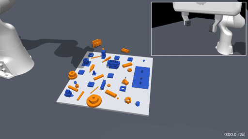
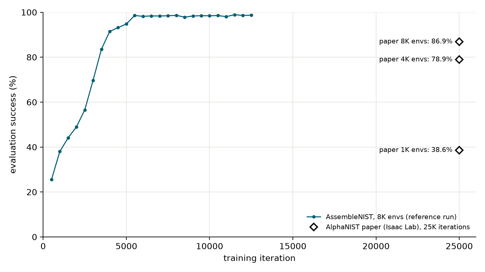
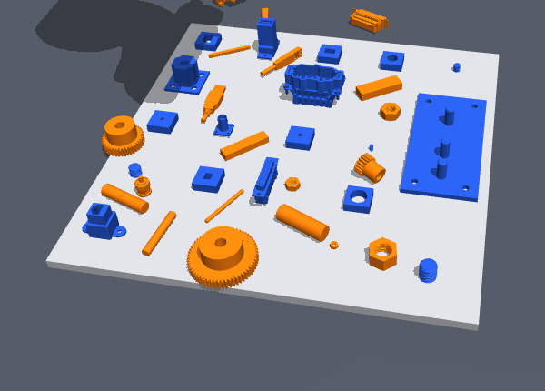
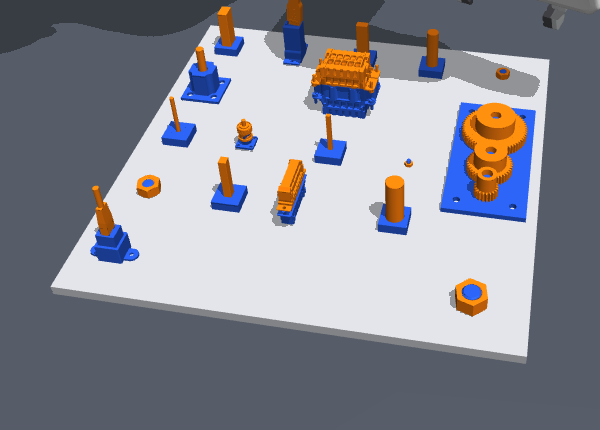

# AssembleNIST: Assembly Policy Learning in MuJoCo

  

By **[Tao Sun](https://taosun.io) | Stanford University**

<!--  -->
https://github.com/user-attachments/assets/81129b64-3911-485c-b9f9-cc1282c2d831


*A single reinforcement-learning (PPO) policy for all 20 assemblies of the NIST Assembly Task Board 1 by a Franka arm,
learned from binary rewards with a Franka arm in MuJoCo.*

## Disclaimer

This repository is an **independent implementation** of the approach introduced by
[AlphaNIST](https://alpha-nist.github.io/) and [Success Guided Sampling (SGS)](https://sgs-rl.github.io/).
It is built in MuJoCo environment. 

Since the AlphaNIST hasn’t yet released its source code (as of Oct 21, 2026), I made own design choices for contact modeling, the action space and the start-state
distributions. I am not affiliated with or endorsed by the AlphaNIST authors.

## Evaluation results

With 8,192 parallel environments, the policy reaches **98.4%** evaluation success after 10K PPO iterations, outperforming the AlphaNIST’s performance with less than half of the 25K iterations reported.

**Success rate (%) by training iterations.**

<p align="center"></p>

The full learning curve can be found in
[`results/reference_e8192.csv`](results/reference_e8192.csv).

<table>
<tr>
<td align="center"><br/>20 parts at random initial poses</td>
<td align="center"><br/>After assembly</td>
</tr>
</table>

**Success rate (%) by part type.**

| Part type | Ours<br/>5k iter | Ours<br/>10k iter | Ours<br/>12.5k iter | Original AlphaNIST<br/>25k iter |
| --- | :---: | :---: | :---: | :---: |
| Rods | 96.6 | 98.6 | 98.6 | – |
| Pegs | 96.6 | 98.1 | 98.6 | – |
| Gears | 98.1 | 98.3 | 99.0 | – |
| Nuts | 87.2 | 98.0 | 97.5 | – |
| Connectors | 96.1 | 99.0 | 99.6 | – |
| **Overall** | 94.8 | 98.4 | **98.7** | 86.9 |

**Success rate (%) by starting state.**

| Starting | Ours<br/>5k iter | Ours<br/>10k iter | Ours<br/>12.5k iter | Original AlphaNIST<br/>25k iter |
| --- | :---: | :---: | :---: | :---: |
| Loose | 91.6 | 96.9 | 98.1 | – |
| Pickup | 93.9 | 98.4 | 98.8 | – |
| Transport | 95.1 | 99.4 | 98.8 | – |
| Partial | 97.8 | 98.7 | 99.0 | – |
| Near-mating | 95.7 | 98.7 | 98.7 | – |
| **Overall** | 94.8 | 98.4 | **98.7** | 86.9 |


> [!NOTE]
> Evaluation follows the AlphaNIST protocol: 5 seeds × 32 trials per task, and sampled policy actions. Success requires assembly within 15 seconds without a safety violation.
> Please note that the AlphaNIST result uses a different simulator, asset set, and implementation, so it is not a direct comparison.


**More visuals.** MP4 files can be found in [docs/videos](docs/videos).

<table>
<tr>
<td align="center">https://github.com/user-attachments/assets/60241ac2-89e9-4702-907a-cbec783369f9</td>
<td align="center">https://github.com/user-attachments/assets/8eb57846-5abc-4145-8ebb-3c181249a0fe</td>
<td align="center">https://github.com/user-attachments/assets/d3960eca-87aa-4707-9ef0-f01f1a15aa56</td>
</tr>
</table>


## Quick start

Clone the repository, install the dependencies and build the contact plugin (requires `g++` on x86-64):

```bash
git clone https://github.com/suniique/assembly-nist.git && cd assembly-nist
pip install -e .
bash plugin/build.sh
```

Generate a demo with the pretrained policy:

```bash
MUJOCO_GL=egl python -m assembly_policy.viz.demo --ckpt checkpoints/e8192_it12500.pt --out demo.mp4
```

Use `MUJOCO_GL=osmesa` if EGL is unavailable. The demo generates settled start poses if reset banks are absent;
`--seed` changes the layout and assembly order, and `--pin 2:N16+3:connector` fixes positions in the order.
Pretrained policies after 2.5K, 5K, 7.5K, 10K and 12.5K iterations are in [`checkpoints/`](checkpoints).

## Training and evaluation

First, we need to build the reset banks before training:

```bash
python scripts/build_banks.py --workers 16
```

Evaluate the pretrained policy. It runs 3200 episodes for about one hour on 16 CPU cores:

```bash
python -m assembly_policy.evaluate --policy checkpoints/e8192_it12500.pt --out eval.json
```

For training the policy, you can run with one machine on a smaller environment size (e.g., 512):

```bash
python -m assembly_policy.train --run-dir runs/small --envs 512 --nthread 32
```

To achieve best performance, the default training configuration uses 8,192 environments and 10K PPO iterations. Below is a script to train it on a Slurm cluster. 

<details>
<summary>Distributed training with Slurm</summary>

The reference run used one GPU learner and 960 CPU worker processes across about 30 nodes,
reaching 10K iterations in roughly 26 hours. Adjust worker counts to your cluster.

```bash
sbatch scripts/slurm/build_banks.sbatch
sbatch --export=ALL,RUN_DIR=runs/e8192,NCONN=960 scripts/slurm/learner.sbatch
for i in $(seq 30); do
  sbatch --export=ALL,RUN_DIR=runs/e8192 scripts/slurm/workers.sbatch
done
```

The first command builds reset banks as a job array; skip it if the banks already exist.
The learner and workers must share the run directory. For clusters without Slurm, use
`assembly_policy.train --remote-workers` and `scripts/workers.sh`.

</details>

## GPU simulation backends

Training and evaluation can also simulate all environments on one GPU (`assembly_policy/sim/gpu`), with the CPU
environment's MDP (actions, gripper latch, observations, rewards, terminations) in torch:

- **`--backend mjwarp`**: [MuJoCo Warp](https://github.com/google-deepmind/mujoco_warp) runs the same task models
  (one model per task, a world per environment). The SDF plugin (thread and connector SDFs) is ported to Warp as
  MuJoCo Warp's user SDFs (`warp_sdf.py`).
- **`--backend mmp`**: Metamorphysics (a CUDA rigid-body engine with robots in reduced coordinates). The Menagerie
  Panda becomes an articulation with the libfranka gains as implicit PD drives, its fingers coupled as by the MuJoCo
  equality; parts, fixtures and the board are convex shapes taken from the task models, with the models' collision
  bitmasks. How nuts' and connectors' SDFs collide is `--backend-kw '{"geometry": ...}'`: `"mjwarp"` (default:
  MuJoCo Warp's SDF contacts, handed to Metamorphysics' solver), `"sdfdcd"` (Metamorphysics' SDF collider) or
  `"mjfit"` (convex threads from [mjfit](https://github.com/younghyopark/mjfit); nuts only).

```bash
pip install mujoco-warp warp-lang          # --backend mjwarp
bash plugin/build.sh                       # the plugin for this environment's MuJoCo (kept per version)
python -m assembly_policy.evaluate --policy checkpoints/e8192_it12500.pt --backend mjwarp --out eval_mjwarp.json
python -m assembly_policy.evaluate --policy checkpoints/e8192_it12500.pt --backend mmp --out eval_mmp.json
python -m assembly_policy.train --run-dir runs/mmp --backend mmp --envs 4096
```

On a GPU backend each environment keeps one task (an equal share per task), and the success-guided sampler draws
each environment's starts among its own task's bank entries.

The pretrained policy (`e8192_it12500.pt`, trained on CPU MuJoCo) on the evaluation protocol above (3200 episodes;
one RTX 5090 for the GPU backends, 16 CPU threads for MuJoCo):

| Backend | Success | Safety | Wall time |
| --- | :---: | :---: | :---: |
| CPU MuJoCo | 98.9% | 0.8% | 58 min |
| MuJoCo Warp | 95.6% | 1.9% | 4.2 min |
| Metamorphysics | 96.3% | 1.5% | 1.4 min |

| Task | R4 | R8 | R12 | R16 | P4 | P8 | P12 | P16 | Gs | Gm | Gl | N4 | N8 | N12 | N16 | BNC | DSUB | RJ45 | USB | WP |
| --- | :-: | :-: | :-: | :-: | :-: | :-: | :-: | :-: | :-: | :-: | :-: | :-: | :-: | :-: | :-: | :-: | :-: | :-: | :-: | :-: |
| CPU MuJoCo | 99 | 98 | 99 | 100 | 96 | 99 | 99 | 98 | 99 | 100 | 99 | 99 | 100 | 98 | 99 | 99 | 99 | 99 | 99 | 99 |
| MuJoCo Warp | 98 | 99 | 100 | 100 | 96 | 98 | 99 | 98 | 99 | 100 | 99 | 99 | 99 | 98 | 38 | 100 | 98 | 99 | 97 | 98 |
| Metamorphysics | 99 | 99 | 100 | 100 | 94 | 88 | 98 | 99 | 100 | 99 | 98 | 91 | 98 | 95 | 95 | 100 | 99 | 94 | 88 | 92 |

MuJoCo Warp matches the CPU on every task but N16 (the M16 nut), not resolved yet. For Metamorphysics: its contact
stiffness is limited by the sub-step (0.125 / sub-step), so a control step is 4 collision detections of 16 sub-steps
of 0.625 ms, which keeps the 35 N grip from sinking into parts; and the fingers' friction is 1.25 instead of
MuJoCo's 2.0, since MuJoCo's soft friction lets a pushed part creep in the grasp (into the palm, where pegs align),
which Metamorphysics' Coulomb friction does not.

## What failed first and turned out to matter most?

My first long runs on 8k environments stalled out at a 46% success rate after 23k iterations. Getting the policy to learn efficiently
took several non-obvious changes. Below are the lessons that I feel matter most.

1. **Keeping RL exploring helps in this task.** With entropy 0.001, an initial std of 0.5 and a std floor of 0.1, the SR crept up about 1 point per
   1000 iterations. A learned std starting at 1.0 with no floor and entropy 0.005 reached 49% after 2000 iterations
   and 98% after 5500.
2. **Make the wrist fast enough to finish in 15s.** Under the `libfranka` gains, a relative target $$q + s \cdot a$$ never fully catches up. With a uniform 0.02 rad scale, the wrist took 15–27s just to rotate 90°. Tuning per-joint scales to give every joint ~0.5 rad/s per unit action finally made reorientation possible.
3. **Fix the physics before tuning RL.** Nut-threading sat at 0% SR because its sharp thread tips were getting stuck in MuJoCo's SDF contact. Adding 0.2 mm of radial clearance let the nuts spin freely without skipping threads. I also had to tune the timestep: gear teeth and threads needed 0.5 ms steps with stiff contacts.

**Final design**

- **Policy:** a SimBa-style actor and critic trained with PPO, using part, fixture, and gripper point clouds
  plus proprioception history.
- **Control:** relative joint-position targets and a binary gripper at 25 Hz with libfranka impedance gains,
  per-joint action scales, and an action-rate penalty.
- **Reward:** binary assembly success at 1 mm keypoint tolerance, with small control penalties.
  Episodes end on success, a joint-speed violation, or the 15-second limit.
- **Start states:** loose, pickup, transport, partial, and near-mating poses, sampled with SGS.
- **Contacts:** primitive geometry for rods and pegs, convex gear teeth, helical-thread SDFs for nuts and bolts,
  and mesh SDFs for connectors. Gears and nuts use 0.5 ms simulation steps and other parts use 2.5 ms.

## Acknowledgements

This project builds on 

- *AlphaNIST: Emergent Assembly Skills from Binary Task Rewards*.
- *A Balanced Data Diet: Addressing the Exploration Bottleneck in Mega-Scale RL for Robot Control*
(Zhang et al., 2026).

Sincerely thanks to [Octi Zhang](https://zoctipus.github.io) for grateful guidance with training details (including reset bank configurations, PPO settings, and state sampling) and [Jing Zhang](https://jingz6676.github.io/) for insightful discussions!
The NIST board assets come from [UW Lab](https://github.com/UW-Lab/UWLab) and the robot model from
[MuJoCo Menagerie](https://github.com/google-deepmind/mujoco_menagerie).

## Citation

If you use AssembleNIST, please cite this repository together with AlphaNIST and SGS
(all entries are also in [`CITATION.bib`](CITATION.bib)):

```bibtex
@misc{sun2026assemblenist,
  title        = {AssembleNIST: One Policy for All NIST Board Assemblies in MuJoCo},
  author       = {Sun, Tao},
  year         = {2026},
  howpublished = {\url{https://github.com/suniique/assembly-nist}}
}

@article{zhang2026alphanist,
  title   = {AlphaNIST: Emergent Assembly Skills from Binary Task Rewards},
  author  = {Zhang, Octi and Akinola, Iretiayo and Scalise, Rosario and Guaman Castro, Mateo and Yin, Patrick and
             Widmer, Tobias and Macklin, Miles and Amevor, Chris and Turpin, Dylan and Van Gelder, Dirk and
             Carius, Jan and Handa, Ankur and State, Gavriel and Guo, Yunrong and Narang, Yashraj},
  journal = {arXiv preprint arXiv:2610.13354},
  year    = {2026}
}

@article{zhang2026sgs,
  title   = {A Balanced Data Diet: Addressing the Exploration Bottleneck in Mega-Scale RL for Robot Control},
  author  = {Zhang, Octi and Guaman Castro, Mateo and Yin, Patrick and Dagnino, Ignacio and Gupta, Abhishek and
             Scalise, Rosario and Boots, Byron},
  journal = {arXiv preprint arXiv:2610.12465},
  year    = {2026}
}
```

## License

The code is released under the [MIT License](LICENSE). See
[`THIRD_PARTY.md`](THIRD_PARTY.md) for third-party assets, codes, and their licenses. 

## Contact

For questions and feedback, please reach out to taosun@stanford.edu.
